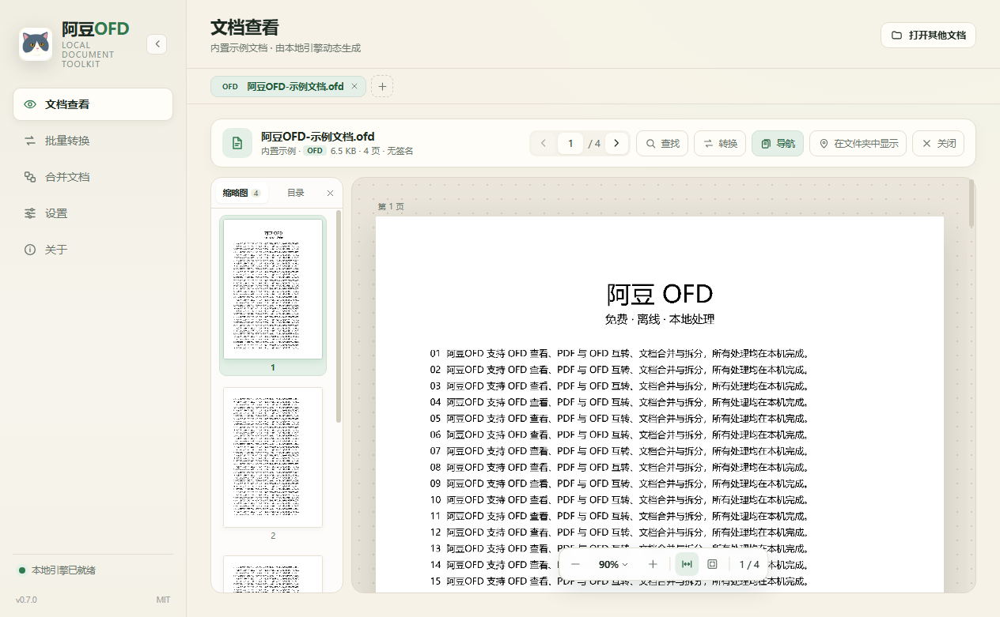
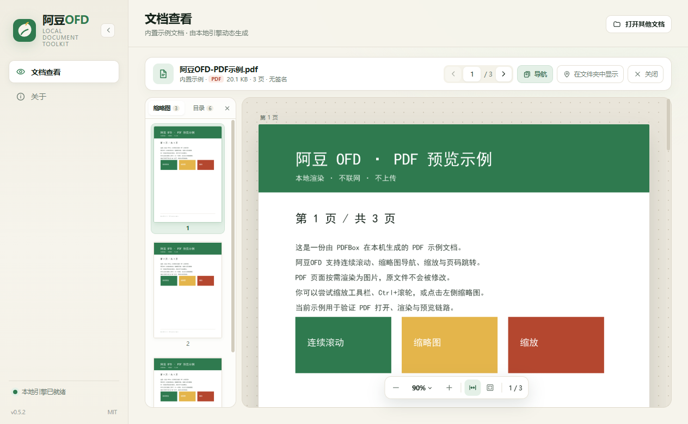
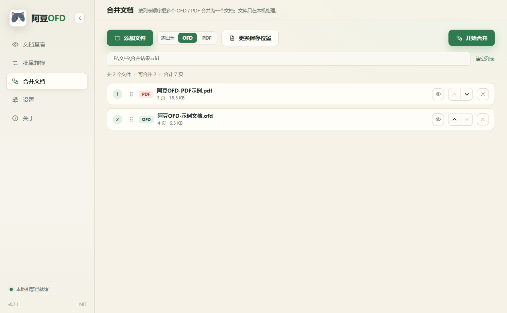
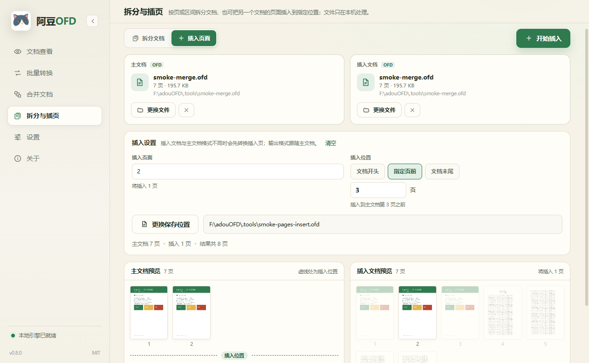
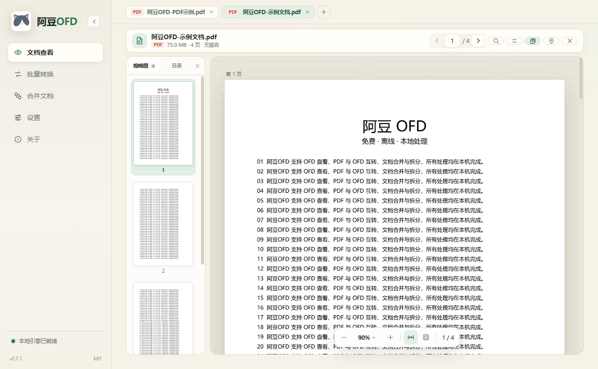
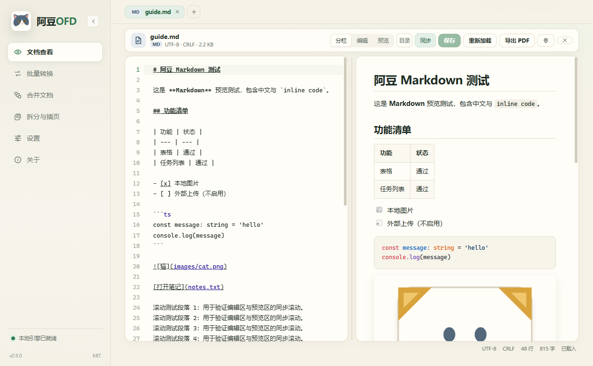
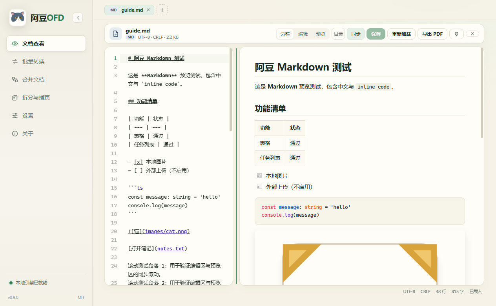

# 阿豆OFD

<p align="center">
  
</p>

<p align="center">
  <strong>免费、离线的 OFD / PDF / Markdown 桌面阅读与编辑工具</strong><br>
  阅读 · 搜索 · 打印 · 转换 · 合并 · 拆分与插页 · Markdown 编辑 · Windows 文件关联
</p>

<p align="center">
  <a href="LICENSE">MIT License</a> ·
  Electron 45.1.0 · Java 25 LTS · ofdrw 2.5.1 · PDFBox 3.0.8
</p>

<p align="center">
  <a href="https://github.com/Zzuser/adouOFD/actions/workflows/ci.yml"></a>
  <a href="https://github.com/Zzuser/adouOFD/releases"></a>
  <a href="PRIVACY.md"></a>
</p>

> 源码：<https://github.com/Zzuser/adouOFD>（镜像：<https://gitcode.com/Zzuser/adouOFD>）  
> 当前版本：**1.1.2**（Javalin 6 本地引擎，启动约 0.4–0.8 秒；OFD / PDF / Markdown 阅读与编辑、转换、合并、拆分插页、打印与搜索；支持关于页检查更新与应用内升级）

## 品牌与图标

- 应用图标为灰白猫正脸头像，白色圆角底；空状态、引擎启动与关于页共用同一角色素材，阅读与处理界面不使用大幅插画。
- 主色：豆绿 `#2F7A4F`；背景：奶油纸 `#F6F2E7`；高亮：眼金 `#E4B54B`；鼻粉 `#E8A6A0` 仅作微点缀。
- **文件图标**：OFD / PDF / Markdown 共用“奶油纸 + 对称金色折角（猫耳）+ 简约猫脸”版式，两只前爪搭在豆绿 / 印章红 / 深灰蓝标签顶部，像把标签举在胸前；已写入 Windows `DefaultIcon`，16–256px 多尺寸 ICO。


## 功能

- **OFD / PDF 查看**：本地打开或拖拽电子发票、公文、合同等 OFD / PDF 文件
- **Markdown / 文本编辑**：打开或新建 `.md` / `.markdown` / `.txt`；源码编辑 + GFM 实时预览，支持表格、任务列表、代码高亮、本地图片与相对链接；分栏比例可拖动，标题目录跳转、编辑/预览同步滚动、`Ctrl+S` 保存；自动识别 UTF-8 / UTF-16 / GB18030 并保持 BOM 与 CRLF/LF；可把预览导出为 A4 PDF
- **编码与保存安全**：文本最大 16 MB；原子写入；文件被其他程序修改时提示覆盖或重新加载；关闭标签和退出应用前确认未保存修改
- **OFD ↔ PDF 转换**：阅读时一键转换，保留页面尺寸与文字；大文档自动分片 + 多线程转换，进度、取消、页数校验与质量提示
- **批量转换标签页**：拖入多个文件、选好输出目录即可批量互转；逐个进度、可中途停止、同名自动改名；每行可直接“查看”源文件或转换结果
- **合并文档标签页**：拖入多个 OFD / PDF，拖动或上下调整列表顺序，选择输出 OFD / PDF 后合并；混合格式会先转换到目标格式，最多 100 个文件；每个文件可一键查看
- **拆分与插页标签页**：按页、每 N 页或自定义区间拆分 OFD / PDF；也可把另一个文档的指定页插入主文档开头、指定页前或末尾。混合格式自动转换，页面预览标出拆分组、选中页和插入位置
- **多标签查看**：同时打开多个文档，标签切换保留阅读位置与缩放状态；最多同时打开 8 个
- **Windows 文件关联**：安装版自动注册 `.ofd` / `.pdf` / `.md` 的“打开方式”，分别使用 OFD / PDF / Markdown 文件图标；双击文件会并入已打开窗口；不覆盖你已选择的默认应用，可在“设置”中修复/移除或打开系统默认应用设置
- **连续多页预览**：页面按需渲染，大文档滚动不一次性加载全部高清图
- **缩略图 + 目录**：缩略图高亮跳页；PDF Outline、OFD Outlines/Bookmarks 目录跳页并高亮当前章节
- **缩放**：50%–300%、适合宽度、适合页面、Ctrl+滚轮，页面清晰可读
- **页码与快捷键**：页码输入、上一页/下一页、←/→
- **文字选择复制**：逐字文字层，框选复制保留换行；右键选区弹出原生“复制”菜单
- **全文搜索**：阅读器“查找”或 `Ctrl+F` 跨页搜索 OFD / PDF 文本；结果列表逐条定位，页面内高亮当前命中；支持区分大小写，长文档后台扫描并显示进度
- **打印**：阅读器“打印”或 `Ctrl+P` 打开打印面板，实时预览并直接发送到所选打印机；支持份数、灰度、全部/当前页/自定义范围、奇偶页、逆序、纸张大小/方向/边距、每张多页（2/4/6/8/9 页，按行/按列、边框）与双面打印；按页数自动使用 300 / 200 / 150 DPI 渲染；单文件转换、批量转换与合并结果都提供“打印”入口，无需先打开阅读器
- **选区防误选**：拖出文字/页面边界时自动钳制，不会整页选中
- **PDF 兼容**：页面旋转、加密 PDF 密码打开，扫描件按图显示
- **本地处理**：文件不离开本机；不登录、不联网、无广告
- **应用导航折叠**：侧栏可收起为图标栏，阅读区自适应

## 界面

| 空状态 | 关于 |
| --- | --- |
|  |  |

| OFD 多页预览 | PDF 预览 |
| --- | --- |
|  |  |

| 格式转换 | 转换结果 |
| --- | --- |
|  |  |

| 批量转换 | 合并文档 |
| --- | --- |
|  |  |

| 拆分文档 | 插入页面 |
| --- | --- |
|  |  |

| 多标签查看 |
| --- |
|  |

| Markdown 编辑 | 分栏与同步滚动 |
| --- | --- |
|  |  |

更多：[导出 PDF](docs/screenshots/markdown-export.png) · [打印面板](docs/screenshots/print-dialog.png) · [全文搜索](docs/screenshots/search.png) · [设置 / Windows 文件关联](docs/screenshots/settings.png) · [第三方许可](docs/screenshots/license.png) · [隐私政策](docs/screenshots/privacy.png) · [目录页签](docs/screenshots/outline.png) · [OFD 文字选择](docs/screenshots/text-selection.png) · [PDF 文字选择](docs/screenshots/pdf-text-selection.png) · [侧栏折叠](docs/screenshots/sidebar-collapsed.png) · [800 页压力测试](docs/screenshots/stress-800p.png)

## 下载与安装

仓库只包含源码。预编译安装包体积较大（约 181MB，内含 jlink 裁剪的 JRE 25），暂未随仓库提交；可按下述步骤本地构建，或从 GitHub Releases 获取：<https://github.com/Zzuser/adouOFD/releases>。

```powershell
cd desktop
npm install
npm run backend:build
npm run package:inno
```

产物：`desktop/dist-inno/阿豆OFD-<version>-x64-inno.exe`（Inno Setup，按用户安装，无需管理员）。安装向导提供“关联 .ofd / .pdf / .md 文件类型”任务，取消勾选则只安装程序、不写文件关联；构建会自动生成精简 JRE，不再内置完整 JDK。

需要 Inno Setup 6；脚本自动查找 `C:\Program Files (x86)\Inno Setup 6\ISCC.exe`，也可用环境变量 `INNO_SETUP_ISCC` 指定。旧的 NSIS 构建仍可用 `npm run package:win`。

GitHub Actions 发布时会将该文件重命名为 ASCII 的 `adou-ofd-<version>-x64-inno.exe`，并生成 `SHA256-<version>.txt` 供校验。

## 完整性校验

安装包**未做代码签名**（曾申请 SignPath Foundation 免费开源签名，未获批准），Windows SmartScreen 可能提示“未知发布者”。安装前请用 Release 附件中的 `SHA256-<version>.txt` 校验完整性：

```powershell
Get-FileHash .\adou-ofd-<version>-x64-inno.exe -Algorithm SHA256
# 与 SHA256-<version>.txt 中的哈希比对
```

## 快速开始

**环境要求**

- Windows 10/11 x64
- Node.js ≥ 22.12（推荐 24 LTS）
- Maven 3.9.x

**准备项目内 JDK（不修改系统环境）**

```powershell
node scripts/setup-jdk.mjs
```

**安装依赖并启动**

```powershell
cd desktop
npm install
npm run backend:build
npm run dev
```

也可以一步完成引擎构建与启动：

```powershell
cd desktop
npm run dev:all
```

应用启动后会自动拉起本地 Java 引擎（随机端口 + 每次启动随机 Token），主界面显示引擎状态；版本与依赖信息在左侧“关于”中查看。

## 使用

| 操作 | 方式 |
| --- | --- |
| 打开文档 | “打开文档”、拖拽文件到窗口、双击已关联的 `.ofd` / `.pdf` / `.md` |
| 新建文档 | 首页“新建 Markdown”或“新建文本”，选择保存位置后直接编辑 |
| Markdown 编辑 | 分栏 / 编辑 / 预览三种模式；拖动中间分隔线调整宽度；`Ctrl+S` 保存；工具栏“目录”跳转标题 |
| 导出 PDF | Markdown 工具栏“导出 PDF”，按 A4 排版导出当前预览 |
| 文件关联 | 左侧“设置” → Windows 文件关联：注册/修复、设为默认、系统设置、移除 |
| 开源许可 | “关于” → 开源许可：查看第三方声明、MIT 许可、打开许可目录 |
| 检查更新 | “关于” → 版本更新：读取 HTTPS 版本清单，应用内下载并校验 SHA256 |
| 翻页 | 顶部页码输入、‹ ›、`←` / `→` |
| 缩放 | 底部工具条、`Ctrl` + `+/-`、`Ctrl + 0` 适合宽度、`Ctrl + 滚轮` |
| 导航 | “导航”打开缩略图 / 目录页签 |
| 全文搜索 | “查找”或 `Ctrl+F`，输入关键词；`Enter` / `Shift+Enter` 切换命中，`Esc` 关闭 |
| 打印 | 阅读器顶部“打印”或 `Ctrl+P`，在打印面板选择打印机、范围、排版与纸张后打印；转换/合并结果区也可直接打印 |
| 复制文字 | 在页面上框选后 `Ctrl+C`，或右键选择“复制选中文字” |
| 格式转换 | 阅读器顶部“转换” → 选择保存位置 → 开始转换（可取消） |
| 批量转换 | 左侧“批量转换” → 添加/拖入多个文件 → 选输出目录 → 开始（可停止） |
| 收起侧栏 | 左上角折叠按钮；状态会记住 |

## 架构

```text
Electron 主进程
  ├─ 窗口 / 原生对话框 / 右键菜单 / 打开外链
  └─ 启动 Java sidecar：127.0.0.1 + 随机端口 + 随机 Token
          │ HTTP (JSON / PNG)
          ▼
React 渲染进程 ────────────────► Java 引擎（Javalin 6）
  • 连续滚动、缩略图、目录        • OFD：ofdrw Reader / ImageMaker
  • 缩放、页码、逐字文字层        • PDF：PDFBox PDDocument / PDFRenderer
  • 选区钳制、右键复制            • 转换：单工作线程 + 有界队列 + 进度
  • 转换对话框 / 批量转换页       • 目录、渲染缓存、会话管理
```

**技术栈**

| 层 | 组件 |
| --- | --- |
| 桌面 | Electron 45.1.0、electron-vite 6.0.0、electron-builder 26.18.0 |
| 前端 | React 19.3.1、TypeScript 7.0.2、Vite 8.3.5 |
| 运行时 | Temurin JDK 25.0.5 LTS（项目内 `.tools/jdk-25`） |
| 引擎 | Javalin 6.7.0（内嵌 Jetty 11）、ofdrw-full 2.5.1、PDFBox 3.0.8 |
| 构建 | Maven 3.9.16、Node.js 24 LTS、Inno Setup 6 |

## 目录

```text
adouOFD/
├─ backend/                 Java 本地引擎（Javalin + ofdrw + PDFBox）
├─ desktop/                 Electron + React + TypeScript
├─ docs/PRD.md              产品与技术设计
├─ docs/PRD.md              产品与技术设计
├─ docs/STRESS-TEST.md      大文件压力测试报告
├─ docs/screenshots/        界面截图
├─ scripts/                 环境、构建、冒烟、压测脚本
├─ LICENSE                  MIT
├─ THIRD-PARTY-NOTICES.md   第三方组件许可说明
└─ README.md
```

## 测试与压测

```powershell
# 后端测试（39 个用例）
cd backend
$env:JAVA_HOME="../.tools/jdk-25"
mvn test

# UI 冒烟（真实 Electron + Java 引擎）
cd ..\desktop
npm run build
npm run smoke:ui

# 大文件压力测试
npm run stress:fixtures
npm run stress:backend
npm run stress:ui
```

压力夹具：800 页矢量 PDF、100 页约 20MB 图片 PDF、91 页 OFD。结果见 [docs/STRESS-TEST.md](docs/STRESS-TEST.md)。

## 隐私

- 文档处理都在本机完成，不上传文档；更新检查只读取版本清单
- 本地引擎仅监听 `127.0.0.1`，每次启动随机 Token
- 不收集遥测；默认不访问网络，仅用户点击“检查更新”或“开源仓库”时主动联网
- 用户原文件只读，转换/合并/拆分默认写入新文件

## 路线图

- **M1.2**：全文搜索（已实现）/ Windows 文件关联（已实现）/ 页面旋转（已实现）/ 最近文件（已实现）
- **M2**：PDF ↔ OFD 转换（单文件 + 批量标签页已实现）
- **M3**：合并（已实现，支持 OFD / PDF 混合与顺序调整）/ 拆分与插页（已实现）
- **1.1.2**：安装器“文件关联”和“桌面快捷方式”在新安装与升级时默认勾选；更新包校验后可点击“运行安装包”启动升级
- **1.1.1**：修复只读 OFD 合并、非 ISO 附件日期导致 PDF 转换失败、组合对象签章偏移；合并 PDF 新增自动/矢量/图像三档；新增关于页检查更新与应用内下载 + SHA256 校验
- **1.1.0**：本地引擎由 Spring Boot 迁移到 Javalin 6（运行时无 Spring 依赖），热启动约 0.4 秒、首次约 0.8 秒，jar 约 36MB；HTTP API 与功能保持不变，54 个后端测试与完整 UI 冒烟通过
- **1.0.0**：首个稳定版；页面旋转、最近文件、文档属性、加密 PDF 密码打开、Markdown / 文本编辑与导出 PDF；PDF 注解显示、打印第二档（页码 / 页眉页脚 / 水印 / 多文档）后续小版本推进
- **M4**：安装包进一步瘦身（目标 <150MB）、自动更新（当前已实现手动检查 + 应用内下载与 SHA256 校验，自动安装待安装包签名完善后评估）

## 已知限制

- 扫描件 PDF/OFD 无文本层，只能按图像查看
- PDF 转 OFD 按 PDF 内嵌字体自动选择：字体完整嵌入时输出可选中文字；字体为子集（多数真实 PDF）时按矢量图形输出，版面一致但文字不可选中，报告会提示
- OFD 转 PDF 在系统缺少可替代字体时会自动改为图像导出（报告会提示），此时文字同样不可选中
- PDF 转 OFD 会在内存中构建整份文档：≤120 页单次转换（约 18 秒），更多页数自动拆成约 10 片、多线程转换后合并（404 页 / 27MB 手册：2GB 堆、约 60 秒、峰值约 1.5GB、输出 190MB）。引擎堆按物理内存 1/16 分配（1–2GB），内存仍不足时会明确提示并终止该任务（不会卡住界面）
- OFD 竖排、带复杂 CTM 旋转的文字层仍需适配；PDF 多栏阅读顺序依赖 PDFBox
- 加密 PDF 需输入打开密码；密码仅用于本次打开，不保存、不写入日志
- Markdown / 文本编辑上限 16 MB；本地图片只展示已打开文档所在目录内的文件，网络图片不加载；Markdown 导出 PDF 使用 A4 与当前预览内容，不包含编辑器工具栏
- 加密 PDF 的密码输入目前仅用于阅读器；批量转换、合并、拆分与插页遇到加密 PDF 会提示失败
- 超大文档（1000+ 页 / 100MB+）尚未压测；页面与缩略图 DOM 会随浏览增长
- 安装包未做代码签名，Windows SmartScreen 可能提示“未知发布者”，请用 SHA256 校验完整性
- OFD 转 PDF 的矢量模式会嵌入完整中文字体，文件体积可能明显大于源文件；对体积敏感时可按图像导出
- 合并结果不保证保留各文件的目录/书签；混合格式合并需要先转换，PDF→OFD 的文字是否可选中取决于源 PDF 字体
- 源 OFD 若引用了包内缺失的图片/字体资源，合并前会补充透明/空占位文件以继续合并，相关图片可能无法显示
- 合并前会展开 OFD 的 DrawParam 样式继承，避免发票表格框线/颜色在合并后丢失；缺失的水印本身仍可能不显示
- 单次最多合并 100 个文件；超大文档合并受内存限制，失败时会明确提示
- 查看器最多同时打开 8 个标签（与本地引擎会话上限一致）；后台标签会保留会话与渲染状态

## 参与贡献

欢迎提交 Issue / Pull Request：

- 源码：<https://github.com/Zzuser/adouOFD>（镜像：<https://gitcode.com/Zzuser/adouOFD>）
- 贡献指南：[CONTRIBUTING.md](CONTRIBUTING.md)
- 支持与问题反馈：[SUPPORT.md](SUPPORT.md)
- 安全漏洞：[SECURITY.md](SECURITY.md)，请勿公开敏感文档
- 变更记录：[CHANGELOG.md](CHANGELOG.md)
- 提交前请运行后端测试、`npm run typecheck` 与 `npm run smoke:ui`
- 不要提交用户文档、真实发票、密钥或大体积安装包

## 许可与隐私

应用代码以 [MIT License](LICENSE) 发布。第三方组件、版权与完整许可文本见 [THIRD-PARTY-NOTICES.md](THIRD-PARTY-NOTICES.md) 与 [licenses/](licenses/)；安装包会将它们复制到 `resources/notices/`，也可从“关于 → 开源与隐私”查看。ofdrw 2.5.1 已移除 iText，依赖树中不再包含 AGPL 组件。

隐私政策见 [PRIVACY.md](PRIVACY.md)：应用离线运行，不上传文档，不包含遥测、账号、广告或云同步；本地日志、临时文件和文件关联的存储位置与清理方式均有说明。
